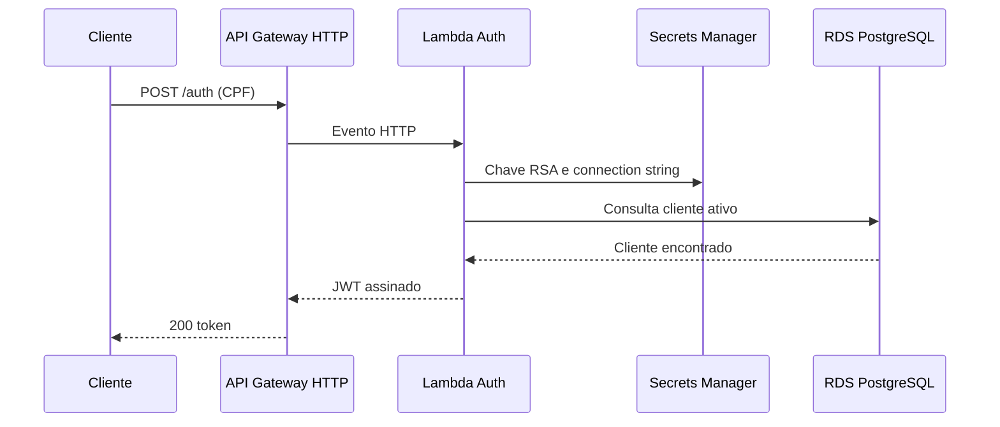

# Garage Management Lambda

Repositorio da funcao serverless de autenticacao do Garage Management. A Lambda valida o CPF, consulta o cliente ativo no PostgreSQL e emite um JWT RSA para consumo das APIs protegidas.

## Repositorios da solucao

- [API principal](https://github.com/kmlyteixeira/garage-management-api-dotnet)
- [Lambda de autenticacao](https://github.com/kmlyteixeira/garage-management-lambda)
- [Infraestrutura EKS/API Gateway](https://github.com/kmlyteixeira/garage-management-infra)
- [Infraestrutura RDS PostgreSQL](https://github.com/kmlyteixeira/garage-management-database)

## Responsabilidades e limites

- Receber `POST /auth` pelo API Gateway com `{ "cpf": "12345678901" }`.
- Validar formato e digitos do CPF sem registrar o documento completo.
- Consultar `Customer` com acesso somente leitura e rejeitar cliente inexistente ou inativo.
- Emitir JWT assinado com chave RSA fora do codigo, com issuer, audience, subject e expiracao curta.
- Expor `GET /.well-known/jwks.json` para validacao da assinatura pela API Gateway/API.
- Retornar `200` com token, `400` para payload invalido, `401` para CPF inexistente/inativo e `500` para falha inesperada.

A Lambda nao possui regras de ordem de servico, migrations ou entidades duplicadas. O contrato de claims e JWKS esta em [RFC-003](https://github.com/kmlyteixeira/garage-management-api-dotnet/blob/main/docs/architecture/rfc/003-authentication-strategy.md).

## Arquitetura



## Configuracao

Segredos devem ser fornecidos por AWS Secrets Manager/Parameter Store ou GitHub Environment. Exemplo local somente para testes:

```text
ConnectionStrings__Default=Host=localhost;Port=5432;Database=GarageManagement;Username=garage_user;Password=Gm9!rT4#vQ7@pL2
JWT_ISSUER=garage-management-auth
JWT_AUDIENCE=garage-management-api
JWT_LIFETIME_MINUTES=15
JWT_PRIVATE_KEY_PEM=<chave-RSA-privada-de-desenvolvimento>
AWS_REGION=us-east-1
LAMBDA_FUNCTION_NAME=garage-management-auth-development
```

O valor de senha acima e apenas um exemplo aleatorio para desenvolvimento. Nao reutilize em cloud. Nunca registre CPF completo, JWT, chave privada ou connection string.

## Execucao e testes

Pre-requisitos: .NET 8 SDK, Docker e credenciais AWS somente para deploy.

```bash
dotnet restore GarageManagement.AuthLambda.sln
dotnet build GarageManagement.AuthLambda.sln --configuration Release
dotnet test GarageManagement.AuthLambda.sln --configuration Release
docker build -t garage-management-auth-lambda:local .
```

A migration que cria `Customer.IsActive` deve estar aplicada antes do primeiro uso. Ela fica no repositorio da API e e executada pelo DbMigrator.

## CI/CD e seguranca

- `ci.yml`: restore, build, testes unitarios e build da imagem Docker em pull requests e nas branches `main`/`develop`.
- `deploy.yml`: deploy manual controlado por GitHub Environment, usando OIDC e permissao minima.
- Variaveis obrigatorias do Environment: `AWS_DEPLOY_ROLE_ARN`, `LAMBDA_EXECUTION_ROLE_ARN`, `AWS_REGION` e `LAMBDA_FUNCTION_NAME`.
- `main` e `master` devem ser protegidas: somente Pull Request aprovado, checks obrigatorios e sem push direto.
- Branch `develop` representa homologacao; `main` representa producao. Deploys devem exigir aprovacao do Environment correspondente.
- O pipeline nao deve armazenar chaves privadas no repositorio; prefira Secrets Manager e rotacao de chaves.

## Observabilidade

Logs sao JSON e devem conter `request_id`, resultado da autenticacao, latencia e nome da operacao, sem CPF completo ou token. CloudWatch deve manter metricas de invocacao, erro, duracao, throttling e alarmes para falha de autenticacao e timeout de banco.

## Entrega

- [Contrato e RFCs](https://github.com/kmlyteixeira/garage-management-api-dotnet/tree/main/docs/architecture)
- [API principal e Swagger](https://github.com/kmlyteixeira/garage-management-api-dotnet)
- [Infraestrutura de plataforma](https://github.com/kmlyteixeira/garage-management-infra)
- [Infraestrutura do banco](https://github.com/kmlyteixeira/garage-management-database)
